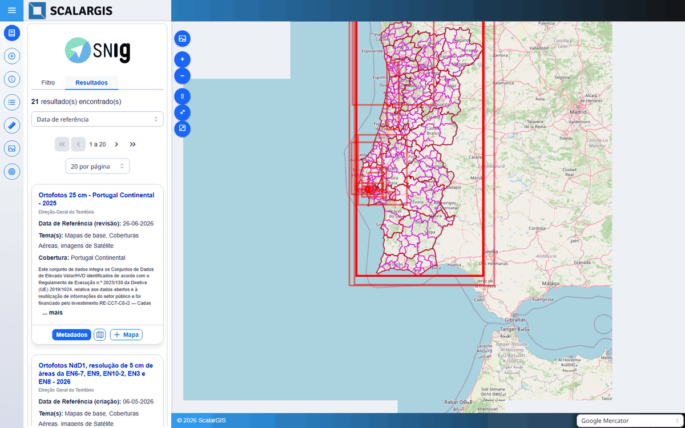
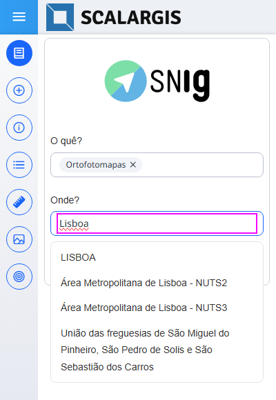
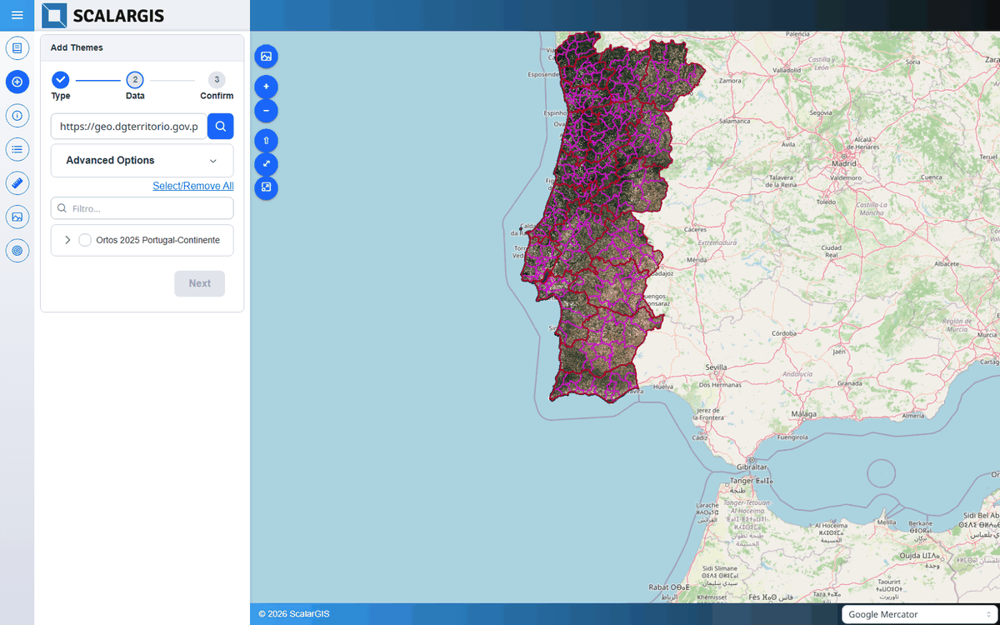

# CatalogoSNIG

CatalogoSNIG adds a metadata catalogue search to a [ScalarGIS](https://scalargis.com) map viewer. It searches the
catalogue of SNIG, the Portuguese National Geographic Information System, and adds the map services of a record to the
map. It also works with any catalogue on [GeoNetwork 3.x](https://geonetwork-opensource.org/manuals/3.12.x/en/index.html),
and with a list of catalogues.

It is a frontend component of the [scalargis-client](https://github.com/scalargis/scalargis-client#readme). It needs
no server extension: the browser calls the catalogue directly.

[Live demo](https://demo.scalargis.com/mapa/catalogosnig) · [ScalarGIS docs](https://docs.scalargis.com)



## Install

1. Put this repo in the components folder of the viewer app of `scalargis-client`. A clone or a symbolic link works:

   ```powershell
   cd scalargis-client/apps/viewer/src/app/components
   git clone https://github.com/scalargis/CatalogoSNIG.git
   ```

   The folder name must be `CatalogoSNIG`.

2. Build the viewer and copy it into the server:

   ```powershell
   cd scalargis-client
   npx nx run viewer:build-deploy-server
   ```

   For development, restart `npx nx serve viewer` instead.

3. Add the component to a viewer config in the backoffice (see [Configuration](#configuration)).

| Branch | Client line |
|---|---|
| `main` | Mantine (current client) |
| `prime-react` | PrimeReact (old client) |

## Features

With no extra config, the panel gives the search of the
[SNIG National Register of Geographic Data](https://snig.dgterritorio.gov.pt/rndg). The panel text is in Portuguese.

- **"O quê?" (What?) and "Onde?" (Where?).** Both filters suggest values while the user types. "Onde?" takes a
  region: a NUTS area, a district, a municipality, or a parish.

  

- **Results.** "Pesquisar" (Search) runs the search. The results tab lists the records and draws their extents on the
  map. A summary by classifier refines the search.
- **Metadata.** Each record opens its full metadata sheet.
- **"+ Mapa" (Add to map).** The button shows on a record with a WMS, WMTS, or WFS service. It opens the service in the
  Add Themes wizard, and the chosen layers go to the map and the table of contents.

  

"+ Mapa" needs the `ThemeWizard` component in the same viewer.

## Configuration

Add an entry to `components` in the viewer config. This entry is enough for the SNIG catalogue:

```json
{
  "id": "catalogosnig",
  "type": "CatalogoSNIG",
  "title": "Catálogo SNIG",
  "icon": "pi pi-briefcase",
  "target": "mainmenu",
  "config_json": {
    "url": "https://snig.dgterritorio.gov.pt/rndg"
  },
  "children": []
}
```

### Main keys

| Key | Default | Effect |
|---|---|---|
| `url` | `https://snig.dgterritorio.gov.pt/rndg` | Base URL of the GeoNetwork catalogue |
| `config_url` | none | Loads the rest of the catalogue config from this JSON URL |
| `search_action` | `searchCatalogSNIG` | `searchCatalog` for a plain GeoNetwork 3.x catalogue |
| `filters[]` | the SNIG filters | `id`, `type`, `label`, `query`, and `options` of each filter |
| `content_header`, `show_content_header` | the SNIG header, `true` | The header of the panel |
| `sortOptions[]`, `sortBy` | date, entity, title, theme | Sort fields of the result list |
| `summary` | the default dimensions | The summary by classifier |
| `allow_add_map` | `true` | `false` hides "+ Mapa" |
| `allow_service_types` | all | Service types that "+ Mapa" offers, for example `["WMS", "WMTS"]` |
| `show_extents` | `true` | `false` hides the record extents on the map |
| `external_search_params` | `false` | `true` reads a search from the page URL |

Filter types: `AnySNIG` and `RegionsSNIG` (the SNIG text and region search), `Any` (free text with suggestions),
`List` (values from the suggest route), `Tags` (the tags API), `DateRange` (two query fields), and `MapExtent` (the
map extent).

### Another GeoNetwork 3.x catalogue

Set `url` and `search_action`, and pick the filters that the catalogue supports:

```json
{
  "id": "mycatalogue",
  "type": "CatalogoSNIG",
  "title": "My catalogue",
  "target": "mainmenu",
  "config_json": {
    "url": "https://example.org/geonetwork",
    "search_action": "searchCatalog",
    "sortOptions": [
      { "value": "relevance", "label": "Relevance" },
      { "value": "title", "label": "Title" }
    ],
    "sortBy": "relevance",
    "filters": [
      {
        "id": "what", "type": "Any", "label": "What?", "query": "anylight",
        "options": {
          "multi": true, "forceSelection": false,
          "suggest": { "path": "/srv/eng/suggest", "field": "anylight", "sortBy": "STARTSWITHFIRST" }
        }
      },
      {
        "id": "topic", "type": "Tags", "label": "Topics", "query": "_cat",
        "options": {
          "multi": true, "forceSelection": true, "mode": "any", "field": "code",
          "source": { "path": "/srv/api/0.1/tags", "lang": "eng" }
        }
      },
      {
        "id": "resource_date", "type": "DateRange", "label": "Resource date",
        "query": ["creationDateFrom", "creationDateTo"]
      }
    ],
    "allow_service_types": ["WMS", "WMTS"]
  },
  "children": []
}
```

### Several catalogues

With `catalogs`, the panel opens with a select box of catalogues. Each catalogue has its own filters.

```json
"config_json": {
  "show_content_header": true,
  "catalogs": {
    "url": "https://raw.githubusercontent.com/scalargis/CatalogoSNIG/main/examples/catalogos.json"
  }
}
```

`catalogs` is a list, or `catalogs.url` names a JSON file with the list. Each item has an `id`, a `title`, and a
`config_url` to the config of that catalogue:

```json
[
  {
    "id": "catalogosnig",
    "title": "Catálogo SNIG",
    "config_url": "https://raw.githubusercontent.com/scalargis/CatalogoSNIG/main/examples/snig.json",
    "help": { "as": "external", "url": "https://snig.dgterritorio.gov.pt/rndg" }
  }
]
```

The [`examples`](examples) folder holds more catalogue configs.
